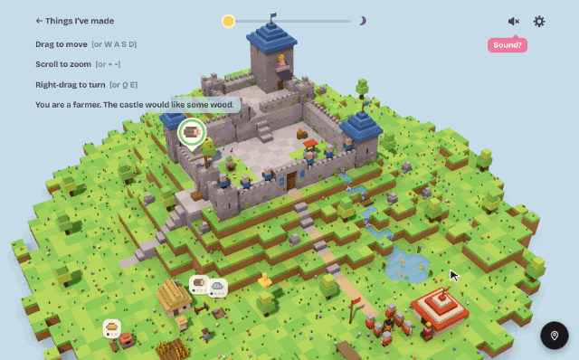

# ai-debug-pins

Click a spot on your dev page, type a line, press Enter. Claude gets a picture of the page with a ring where you
clicked, your words, and where they point in the code. No more screenshot, paste, explain.


Made for [Claude Code](https://claude.com/claude-code): new notes go along with your next message by themselves. Works
with any framework (React, Vue, Svelte, Next.js, plain HTML), on WebGL games as well as plain pages. The notes are plain
files, so **other AI tools can read them too** (see the end).

- Click one thing, drag an area, select some text, or hold Shift for several in one note. <kbd>Alt</kbd>+<kbd>Shift</kbd>+<kbd>P</kbd>
  starts pinning.
- No browser extension, no screen-recording permission: the page draws its own picture.
- Development only: nothing reaches a production build.
- Notes stay in your project, in `.notes/`, which git ignores. Nothing is sent anywhere else.

Needs Node 20.6 or newer.

## Set it up with Claude

Paste this into Claude Code, in your project:

> Set up ai-debug-pins here (https://github.com/TiagoJeronimo/ai-debug-pins): install its Claude Code plugin, then
> add it to my dev server as its README says, for development only. Then tell me how to use it.

Then restart the dev server and Claude Code.

**For Claude, once it is set up:** end by telling the user, in a few short lines:

1. Restart the dev server and Claude Code (the plugin starts with a new session).
2. On any page in development, click the pin at the bottom right, click the thing you mean, type what you want,
   press Enter. Pin as many as you like.
3. Then just write your next message as usual: the notes go with it by themselves. No need to mention them, but you can.
4. "Read my notes" picks up any note not yet done; "clear my notes" deletes the done ones.

## Use

1. On any page in development, click the pin at the bottom right, or press <kbd>Alt</kbd>+<kbd>Shift</kbd>+<kbd>P</kbd>
   (<kbd>⌥</kbd><kbd>⇧</kbd><kbd>P</kbd> on a Mac).
2. Click the thing you mean (it lights up as you hover), type what you want, press Enter. Pin as many as you like.
   - **An area:** drag a box instead of clicking.
   - **Several things in one note:** hold <kbd>Shift</kbd> while you click or drag them, then let go of it to write.
     They are numbered in the picture.
   - **Some text:** select it first, then press the pin. The note is about exactly those words.
3. Back in Claude Code, write your next message as usual, say "fix these". You don't have to mention the notes or
   paste anything: the plugin adds them to whatever you send next. The chat shows
   "📍 2 notes sent with this message", and Claude says what it got, opens each picture, finds the code and does what
   each note asks.

Or say "read my notes" at any time, for every note not yet done.

A handled note stays in the file, marked done, with its picture beside it: a record of what you asked for. Say
"clear my notes" to delete the done ones and their pictures.

Notes live in `.notes/notes.md`, pictures beside them; `.notes/` ignores itself in git. A note looks like this:

```md
## 2026-11-25T14-36-16-914Z · new

> The keep looks too grey. Warmer stone?


- page: http://localhost:5173/games/castle/
- viewport: 1240x895 @2x
- point: 420, 150 (the ring, in CSS pixels)
- element: `#root > main.castle > div:nth-of-type(1) > div > canvas`
- component: Canvas ← Picture ← CastlePage (src/games/Picture.tsx)
```

On React pages it finds the nearest components and the file they are in. A note about several things lists each as
`mark 1`, `mark 2`..., an area as `area: left, top, width x height`.

## Set it up by hand

**1. The Claude Code plugin:**

```bash
claude plugin marketplace add TiagoJeronimo/ai-debug-pins
```

```bash
claude plugin install ai-debug-pins@ai-debug-pins
```

**2a. A Vite project** (Vite, React with Vite, Vue, SvelteKit, Nuxt, Astro, React Router...):

```bash
npm install --save-dev ai-debug-pins
```

(or `pnpm add -D ai-debug-pins`, `yarn add -D ai-debug-pins`, `bun add -d ai-debug-pins`)

```js
// vite.config.js
import debugPins from 'ai-debug-pins'

export default { plugins: [debugPins()] }
```

Frameworks with a config of their own take it under `vite`:

```js
// astro.config.mjs
export default defineConfig({ vite: { plugins: [debugPins()] } })

// nuxt.config.ts
export default defineNuxtConfig({ vite: { plugins: [debugPins()] } })
```

SvelteKit and React Router use `vite.config` as above. Only on `vite serve`: nothing reaches a build.

**2b. Anything else** (Next.js, Angular, webpack, Rails, Django, plain HTML...): run the notes server in your project
folder, beside your dev server,

```bash
npx ai-debug-pins
```

(or `pnpm dlx ai-debug-pins`, `yarn dlx ai-debug-pins`, `bunx ai-debug-pins`)

and add one line to your page, in development only:

```html
<script type="module" src="http://localhost:7777/client.js"></script>
```

In Next.js, for example, in `app/layout.tsx`:

```jsx
{process.env.NODE_ENV === 'development' && <script type="module" src="http://localhost:7777/client.js" />}
```

It takes notes only from pages on your own machine. Another port: `npx ai-debug-pins 7778`.

To stop notes going along with your messages, set `AI_DEBUG_PINS_HOOK=0`; "read my notes" still works.

## The picture



No permission and no extension: the page draws its own picture
([modern-screenshot](https://github.com/qq15725/modern-screenshot)), right after it has drawn a frame, so WebGL comes out
too. Being redrawn, not a screenshot, it can differ in small ways (a stray character from an unusual CSS `content`, a
lighter shadow). Each note says so, and Claude is told to act on your words and the element they point at, never on how
the picture looks.

## Safety

A note goes to an AI agent that is told to act on it, so the server takes notes only from your own machine: the
request has to come from this computer (not the network, even if your dev server listens there) and from a page on
`localhost`, `127.0.0.1`, `[::1]` or `*.localhost`. Any other site open in your browser, including one that points its
DNS at your machine, is turned away. Notes are capped in size and pictures must be PNGs.

Pinning from your phone over the network is therefore not possible. That is on purpose.

## Other AI tools

The notes are Markdown and PNGs, so any agent that reads files and images can use them (Codex, Cursor, Copilot,
Gemini CLI, ...). Add this to your `AGENTS.md`, then say "read my notes":

```md
## Notes pinned on the page

When I say "read my notes", read `.notes/notes.md`. Each `## <id> · <status>` section is a note (`new`, `read` or
`done`); handle every one that is not `done`, oldest first. Open its picture (`.notes/<id>.png`): a red ring is
where I clicked, a red frame an area I dragged or text I selected; several are numbered as `mark 1`, `mark 2`... The `>` quote is what I want; `element`, `text` and `component` point to the code. The picture is
redrawn by the page and can differ slightly from the screen: act on my words, never on how the picture looks. When a
note is handled, change its heading to `· done`.
```

What only Claude Code gets: notes going along with your messages by themselves, and the "📍 note sent" line.

## Remove it

Take `debugPins()` out of your Vite config (or the script tag out of your page), then:

```bash
npm uninstall ai-debug-pins
```

```bash
claude plugin uninstall ai-debug-pins@ai-debug-pins
```

## Working on it

```bash
npm run demo   # a page with a WebGL canvas
npm test
```

MIT licence.
