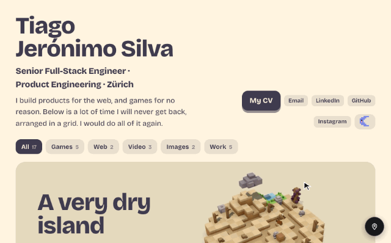

# ai-debug-pins

Click a spot on your dev page, type a line, press Enter. Claude gets a picture of the page with a ring where you
clicked, your words, and where they point in the code. No more screenshot, paste, explain.



Made for [Claude Code](https://claude.com/claude-code): new notes go along with your next message by themselves. Works
with any framework (React, Vue, Svelte, Next.js, plain HTML), on WebGL games as well as plain pages. The notes are plain
files, so other AI tools can read them too (see the end).

## Set it up with Claude

Paste this into Claude Code, in your project:

> Set up ai-debug-pins here (https://github.com/TiagoJeronimo/ai-debug-pins): install its Claude Code plugin, then
> add it to my dev server as its README says, for development only.

Then restart the dev server and Claude Code.

## Use

On any page in development: click ✎ at the bottom right, click a spot, type, Enter (Esc cancels). Back in Claude Code,
send anything ("go"): the chat shows "📍 1 note sent with this message", and Claude says what it got, looks at the
picture, finds the code and does what the note asks. Or say "read my notes" for every note not yet done.

Notes live in `.notes/notes.md`, pictures beside them; `.notes/` ignores itself in git. A note looks like this:

```md
## 2026-11-25T14-36-16-914Z · new

> The keep looks too grey. Warmer stone?


- page: http://localhost:5173/games/castle/
- viewport: 1240x895 @2x
- point: 420, 150 (the ring, in CSS pixels)
- element: `#root > main.castle > div:nth-of-type(1) > div > canvas`
- component: Canvas ← Picture ← CastlePage (src/games/Picture.tsx)
```

On React pages it finds the nearest components and the file they are in.

## Set it up by hand

**1. The Claude Code plugin:**

```bash
claude plugin marketplace add TiagoJeronimo/ai-debug-pins
```

```bash
claude plugin install ai-debug-pins@ai-debug-pins
```

**2a. A Vite project** (Vite, React with Vite, Vue, SvelteKit, Nuxt, Astro, React Router...):

```bash
npm i -D ai-debug-pins
```

```js
// vite.config.js
import debugPins from 'ai-debug-pins'

export default { plugins: [debugPins()] }
```

Only on `vite serve`: nothing reaches a build.

**2b. Anything else** (Next.js, Angular, webpack, Rails, Django, plain HTML...): run the notes server in your project
folder, beside your dev server,

```bash
npx ai-debug-pins
```

and add one line to your page, in development only:

```html
<script type="module" src="http://localhost:7777/client.js"></script>
```

In Next.js, for example, in `app/layout.tsx`:

```jsx
{process.env.NODE_ENV === 'development' && <script type="module" src="http://localhost:7777/client.js" />}
```

It takes notes only from pages on your own machine. Another port: `npx ai-debug-pins 7778`.

To stop notes going along with your messages, set `AI_DEBUG_PINS_HOOK=0`; "read my notes" still works.

## The picture

No permission and no extension: the page draws its own picture
([modern-screenshot](https://github.com/qq15725/modern-screenshot)), right after it has drawn a frame, so WebGL comes out
too. Being redrawn, not a screenshot, it can differ in small ways (a stray character from an unusual CSS `content`, a
lighter shadow). Each note says so, and Claude is told to act on your words and the element they point at, never on how
the picture looks.

## Other AI tools

The notes are Markdown and PNGs, so any agent that reads files and images can use them (Codex, Cursor, Copilot,
Gemini CLI, ...). Add this to your `AGENTS.md`, then say "read my notes":

```md
## Notes pinned on the page

When I say "read my notes", read `.notes/notes.md`. Each `## <id> · <status>` section is a note (`new`, `read` or
`done`); handle every one that is not `done`, oldest first. Open its picture (`.notes/<id>.png`): the red ring is
where I clicked. The `>` quote is what I want; `element`, `text` and `component` point to the code. The picture is
redrawn by the page and can differ slightly from the screen: act on my words, never on how the picture looks. When a
note is handled, change its heading to `· done`.
```

What only Claude Code gets: notes going along with your messages by themselves, and the "📍 note sent" line.

## Working on it

```bash
npm run demo   # a page with a WebGL canvas
npm test
```

MIT licence.
